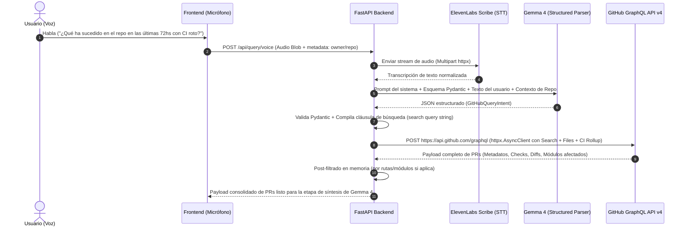

# Planificación Técnica: Pipeline de Audio a GitHub GraphQL API

**Proyecto:** ElevenLabs & Gemma Demo  
**Etapa 1:** De Instrucción Natural en Audio a Request Minada de GitHub  
**Stack Backend:** Python 3.11+, FastAPI, `httpx` (Asíncrono), Pydantic v2  
**Servicios de IA:** ElevenLabs Speech-to-Text (Scribe), Gemma 4 (Structured Outputs)  
**Fuente de Datos:** GitHub GraphQL API v4  

---

## 1. Arquitectura General y Flujo de Datos

El objetivo de esta primera fase es transformar una consulta en lenguaje natural capturada mediante el micrófono del usuario en una consulta optimizada a la API de GitHub, extrayendo un conjunto estructurado y enriquecido de Pull Requests relevantes para su posterior análisis por Gemma 4 y narración por ElevenLabs.

### Diagrama de Secuencia



---

## 2. Ingesta de Audio y Transcripción (Frontend -> FastAPI -> ElevenLabs)

### 2.1. Contrato del Endpoint en FastAPI

- **Ruta:** `POST /api/v1/voice/query-prs`
- **Content-Type:** `multipart/form-data`
- **Parámetros:**
  - `audio`: Archivo binario de audio (formatos recomendados: `audio/webm;codecs=opus` o `audio/wav`).
  - `repo`: *(Opcional)* Cadena en formato `"owner/name"`. Si el frontend tiene seleccionado un repositorio activo, viaja aquí.
  - `time_reference`: *(Opcional)* Timestamp ISO 8601 del cliente para resolver referencias temporales relativas (ej. "ayer", "hace 3 días"). Si se omite, se utiliza el reloj del servidor UTC.

### 2.2. Integración con ElevenLabs Scribe (STT)

FastAPI utiliza `httpx.AsyncClient` para enviar el archivo de audio a la API de ElevenLabs Scribe:

```python
async def transcribe_audio_with_elevenlabs(audio_bytes: bytes, filename: str) -> str:
    url = "https://api.elevenlabs.io/v1/speech-to-text"
    headers = {
        "xi-api-key": settings.ELEVENLABS_API_KEY
    }
    files = {
        "file": (filename, audio_bytes, "audio/webm")
    }
    data = {
        "model_id": "scribe_v1",
        "language_code": "es"  # o detección automática
    }
    async with httpx.AsyncClient(timeout=30.0) as client:
        response = await client.post(url, headers=headers, files=files, data=data)
        response.raise_for_status()
        result = response.json()
        return result.get("text", "")
```

---

## 3. Taxonomía de Mapeo: Lenguaje Natural a Parámetros de GitHub

Gemma 4 interpretará las expresiones naturales mapeándolas a dimensiones concretas de búsqueda y filtrado:

| Dimensión Natural | Expresiones Típicas en Audio | Cláusula GitHub / Filtro GraphQL | Acción de Enriquecimiento / Post-filtro |
| :--- | :--- | :--- | :--- |
| **Ventana Temporal** | *"Últimas 72 horas"*, *"esta semana"*, *"desde el lunes"* | `created:>=YYYY-MM-DDTHH:MM:SSZ` o `updated:>=...` | Se calcula el delta respecto al timestamp actual |
| **Salud de CI / Bloqueos** | *"PRs con tests rotos"*, *"con fallas en CI"*, *"bloqueados por checks"* | `status:failure` o `status:pending` | Inspección detallada del nodo `statusCheckRollup` para aislar jobs específicos |
| **Listos para Integrar** | *"Listos para mergear"*, *"aprobados sin problemas"* | `is:open review:approved status:success draft:false` | `reviewDecision == "APPROVED"` |
| **Nivel de Controversia** | *"PRs calientes"*, *"con mucha discusión"*, *"con cambios pedidos"* | `comments:>5` o `sort:comments-desc` | Inspección de `reviewDecision: "CHANGES_REQUESTED"` y número de comentarios |
| **PRs Estancados (Stale)** | *"PRs abandonados"*, *"que llevan demasiado tiempo abiertos"*, *"dormidos"* | `is:open updated:<={NOW - 14d} sort:updated-asc` | Cálculo de días de inactividad (`days_inactive`) |
| **Quick Wins / Tamaño** | *"PRs fáciles de revisar"*, *"cambios chicos"*, *"quick wins"* | Filtro base `is:open` | En memoria: `(additions + deletions) < 100` y `changedFiles <= 3` |
| **PRs Masivos / Refactors** | *"Grandes refactorizaciones"*, *"cambios pesados"* | Filtro base `is:open` | En memoria: `(additions + deletions) > 500` |
| **Módulos / Rutas** | *"Que afecten el backend"*, *"módulo de auth"*, *"cambios en frontend"* | No soportado nativamente en `search(...)` de GitHub PRs | **Filtrado por `files` en GraphQL:** matcher por glob `backend/**`, `frontend/**` |
| **Bots y Ruido** | *"Ignora a dependabot"*, *"sin bots"*, *"solo código humano"* | `-author:app/dependabot -author:app/renovate` | Exclusión de autores tipo `Bot` |
| **Estado del PR** | *"Qué se mergeó"*, *"PRs abiertos"*, *"cerrados sin mergear"* | `is:merged`, `is:open`, `is:closed -is:merged` | Filtro `state` en GraphQL |

---

## 4. Esquema Tipado Pydantic (`GitHubQueryIntent`)

Gemma 4 recibirá la transcripción y el esquema estructurado de Pydantic para producir una respuesta validada.

```python
from datetime import datetime, timedelta, timezone
from enum import Enum
from typing import List, Optional
from pydantic import BaseModel, Field

class PRStateEnum(str, Enum):
    OPEN = "open"
    CLOSED = "closed"
    MERGED = "merged"
    ALL = "all"

class CIStatusFilter(str, Enum):
    ANY = "any"
    FAILURE = "failure"
    SUCCESS = "success"
    PENDING = "pending"

class ReviewStatusFilter(str, Enum):
    ANY = "any"
    APPROVED = "approved"
    CHANGES_REQUESTED = "changes_requested"
    REVIEW_REQUIRED = "review_required"

class PRSizeCategory(str, Enum):
    ANY = "any"
    SMALL = "small"      # < 100 líneas
    MEDIUM = "medium"    # 100 - 500 líneas
    LARGE = "large"      # > 500 líneas

class SortByEnum(str, Enum):
    UPDATED = "updated"
    CREATED = "created"
    COMMENTS = "comments"

class GitHubQueryIntent(BaseModel):
    """Esquema extraído por Gemma 4 a partir de la instrucción de audio."""
    repo_override: Optional[str] = Field(
        None, 
        description="Si el usuario mencionó explícitamente un repositorio distinto en voz (ej: 'owner/repo')."
    )
    time_window_hours: Optional[int] = Field(
        72, 
        description="Horas hacia atrás a inspeccionar (ej: 72 para 'últimas 72 hs', 168 para 'esta semana')."
    )
    state: PRStateEnum = Field(
        PRStateEnum.OPEN, 
        description="Estado de los PRs solicitados."
    )
    ci_status: CIStatusFilter = Field(
        CIStatusFilter.ANY, 
        description="Filtro de salud de integración continua."
    )
    review_status: ReviewStatusFilter = Field(
        ReviewStatusFilter.ANY, 
        description="Filtro según estado de las revisiones."
    )
    min_comments: Optional[int] = Field(
        None, 
        description="Número mínimo de comentarios si se busca discusión/controversia."
    )
    is_stale: bool = Field(
        False, 
        description="True si se buscan PRs viejos o desatendidos sin actividad reciente."
    )
    size_filter: PRSizeCategory = Field(
        PRSizeCategory.ANY, 
        description="Clasificación de tamaño para quick wins o refactors."
    )
    affected_paths: List[str] = Field(
        default_factory=list, 
        description="Directorios o patrones de archivos afectados (ej: ['backend/', 'src/auth/'])."
    )
    exclude_bots: bool = Field(
        True, 
        description="Excluir bots como Dependabot o Renovate de los resultados."
    )
    sort_by: SortByEnum = Field(
        SortByEnum.UPDATED, 
        description="Criterio de ordenación de los PRs."
    )
    user_summary_goal: str = Field(
        ..., 
        description="Propósito implícito del usuario (ej: 'diagnóstico de bloqueos', 'resumen semanal', 'alerta de bugs')."
    )

    def build_search_query_clause(self, default_repo: str, now: datetime) -> str:
        """Compila la cláusula de búsqueda nativa de GitHub Search."""
        repo = self.repo_override or default_repo
        clauses = [f"repo:{repo}", "is:pr"]

        # Estado
        if self.state == PRStateEnum.OPEN:
            clauses.append("is:open")
        elif self.state == PRStateEnum.MERGED:
            clauses.append("is:merged")
        elif self.state == PRStateEnum.CLOSED:
            clauses.append("is:closed -is:merged")

        # Ventana de tiempo
        if self.time_window_hours:
            cutoff = now - timedelta(hours=self.time_window_hours)
            cutoff_iso = cutoff.strftime("%Y-%m-%dT%H:%M:%SZ")
            if self.state == PRStateEnum.MERGED:
                clauses.append(f"merged:>={cutoff_iso}")
            else:
                clauses.append(f"updated:>={cutoff_iso}")
        elif self.is_stale:
            stale_cutoff = (now - timedelta(days=14)).strftime("%Y-%m-%dT%H:%M:%SZ")
            clauses.append(f"updated:<={stale_cutoff}")

        # CI Checks
        if self.ci_status == CIStatusFilter.FAILURE:
            clauses.append("status:failure")
        elif self.ci_status == CIStatusFilter.SUCCESS:
            clauses.append("status:success")
        elif self.ci_status == CIStatusFilter.PENDING:
            clauses.append("status:pending")

        # Reviews
        if self.review_status == ReviewStatusFilter.APPROVED:
            clauses.append("review:approved")
        elif self.review_status == ReviewStatusFilter.CHANGES_REQUESTED:
            clauses.append("review:changes_requested")
        elif self.review_status == ReviewStatusFilter.REVIEW_REQUIRED:
            clauses.append("review:required")

        # Comentarios
        if self.min_comments:
            clauses.append(f"comments:>={self.min_comments}")

        # Bots
        if self.exclude_bots:
            clauses.append("-author:app/dependabot -author:app/renovate")

        # Orden
        clauses.append(f"sort:{self.sort_by.value}-desc")

        return " ".join(clauses)
```

---

## 5. Extracción con GitHub GraphQL API v4 vía `httpx`

### 5.1. Consulta GraphQL Unificada

Esta consulta resuelve de forma atómica:
1. Filtrado sintáctico de búsqueda mediante `search(query: $searchQuery, type: ISSUE, first: 25)`.
2. Recuperación de archivos tocados (`files`) para filtrar por módulos/carpetas en un solo paso.
3. Recuperación del `statusCheckRollup` (CI/Tests) sin necesidad de peticiones secundarias.
4. Conteo de adiciones y deleciones para clasificar tamaño.

```graphql
query SearchPullRequestsWithContext($searchQuery: String!, $limit: Int = 20) {
  rateLimit {
    cost
    remaining
    resetAt
  }
  search(query: $searchQuery, type: ISSUE, first: $limit) {
    issueCount
    nodes {
      ... on PullRequest {
        number
        title
        url
        state
        isDraft
        createdAt
        updatedAt
        mergedAt
        additions
        deletions
        changedFiles
        author {
          login
          avatarUrl
        }
        reviewDecision
        comments {
          totalCount
        }
        commits(last: 1) {
          nodes {
            commit {
              oid
              statusCheckRollup {
                state
                contexts(first: 10) {
                  nodes {
                    ... on CheckRun {
                      name
                      conclusion
                      status
                      detailsUrl
                    }
                    ... on StatusContext {
                      context
                      state
                      targetUrl
                    }
                  }
                }
              }
            }
          }
        }
        files(first: 30) {
          nodes {
            path
            additions
            deletions
          }
        }
      }
    }
  }
}
```

### 5.2. Cliente Asíncrono en FastAPI (`httpx`)

```python
import httpx
from typing import Dict, Any

class GitHubGraphQLClient:
    GRAPHQL_URL = "https://api.github.com/graphql"

    def __init__(self, token: str):
        self.headers = {
            "Authorization": f"Bearer {token}",
            "Accept": "application/vnd.github.v4+json",
            "User-Agent": "ElevenLabs-Gemma-PR-Agent"
        }

    async def execute_query(self, query: str, variables: Dict[str, Any]) -> Dict[str, Any]:
        async with httpx.AsyncClient(timeout=20.0) as client:
            response = await client.post(
                self.GRAPHQL_URL,
                json={"query": query, "variables": variables},
                headers=self.headers
            )
            response.raise_for_status()
            payload = response.json()
            if "errors" in payload:
                raise RuntimeError(f"GraphQL Errors: {payload['errors']}")
            return payload["data"]
```

### 5.3. Enriquecimiento y Post-filtrado en Memoria

Una vez obtenidos los nodos:
1. **Filtrado por módulo (`affected_paths`):** Se valida si alguno de los `files.nodes.path` coincide con los prefijos solicitados (ej: `path.startswith("backend/")`). Si el usuario especificó módulos pero ningún archivo coincide, se descarta o prioriza el PR.
2. **Filtrado por tamaño (`size_filter`):** Se compara `additions + deletions` contra los umbrales definidos.
3. **Resumen de checks fallidos:** Se extraen los nombres de los checks con `conclusion == "FAILURE"` para facilitárselos a Gemma 4 en la etapa de síntesis.

---

## 6. Manejo de Errores, Rate Limits y Resiliencia

1. **Gestión de Cuota de GitHub:**
   - La API de GraphQL de GitHub cuenta con 5,000 puntos/hora para tokens personales o GitHub App.
   - Cada consulta insufla un costo de ~1 a 2 puntos gracias al uso de conexiones acotadas (`first: 20`, `files: 30`).
   - El payload inspecciona el nodo `rateLimit.remaining`. Si resta menos del 10%, se envía una cabecera de alerta y se activa cacheo temporal en FastAPI (Redis / memoria).
2. **Ambigüedad en la Instrucción del Usuario:**
   - Si la instrucción no contiene fechas ni filtros específicos (ej: *"¿Qué hay de nuevo?"*), Gemma 4 aplicará los valores predeterminados: `time_window_hours = 72` y `state = OPEN`.
3. **Fallas en la Detección de Voz:**
   - Si ElevenLabs Scribe devuelve texto vacío o de muy baja confianza, el endpoint retorna un error estructurado HTTP 422: `"No se reconoció ninguna instrucción clara en el audio"`.
4. **Repositorio Inválido o Sin Permisos:**
   - Si el repositorio no existe o el token carece de lectura, se captura el error de GraphQL devolviendo HTTP 404 o 403 con mensaje explicativo.

---

## 7. Transición hacia la Etapa 2 (Síntesis de Gemma 4 + Audio ElevenLabs)

El resultado final de esta etapa es un objeto estructurado:

```json
{
  "transcribed_text": "¿Qué ha sucedido con este repositorio en las últimas 72 hs con CI roto?",
  "intent": {
    "repo": "owner/repo",
    "time_window_hours": 72,
    "ci_status": "failure",
    "user_summary_goal": "Diagnóstico de bloqueos en integración continua"
  },
  "raw_prs_count": 3,
  "prs": [
    {
      "number": 142,
      "title": "refactor(auth): migrate token validation to jwt-v2",
      "author": "dev-user",
      "updatedAt": "2026-10-10T14:20:00Z",
      "failing_checks": ["test-suite / pytest-backend", "security-audit"],
      "changed_files_count": 8,
      "files_sample": ["backend/auth.py", "backend/routes/login.py"]
    }
  ]
}
```

Este payload constituye la entrada directa para que **Gemma 4** elabore el reporte narrativo condensado (resaltando nombres de PRs, causas de fallos y autores clave), el cual será enviado al endpoint Text-to-Speech de **ElevenLabs** para su locución.

Consulta el diseño detallado de esta siguiente fase en:  
👉 [Planificación Técnica: Síntesis con Gemma 4 y Narración con ElevenLabs TTS](file:///Users/joel/projects/ai/hacktoberfest-hack-day-madrid-2026/.docs/planning_gemma_synthesis_and_elevenlabs.md).

