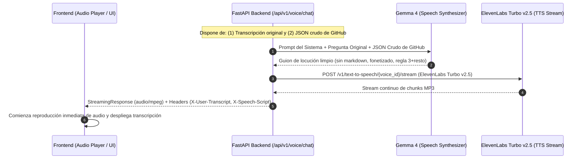

# Planificación Técnica: Síntesis con Gemma 4 y Narración con ElevenLabs TTS

**Proyecto:** ElevenLabs & Gemma Demo  
**Etapa 2:** De Transcripción + Datos de GitHub a Sumario Narrativo y Audio Streaming  
**Stack Backend:** Python 3.11+, FastAPI, `httpx` (Asíncrono), `StreamingResponse`  
**Modelos:** Gemma 4 (Text-to-Text / Audio Scripting), ElevenLabs Turbo v2.5 (Text-to-Speech Streaming)  
**Documento previo:** [Pipeline de Audio a GitHub GraphQL API](file:///Users/joel/projects/ai/hacktoberfest-hack-day-madrid-2026/.docs/planning_audio_to_github_pipeline.md)

---

## 1. Arquitectura General y Flujo de la Etapa 2

Esta fase toma dos inputs esenciales:
1. **La transcripción de la consulta original del usuario** (obtenida previamente por ElevenLabs Scribe).
2. **El payload JSON crudo** retornado directamente por la consulta de GitHub GraphQL API v4.

A partir de ellos, **Gemma 4** actúa como redactor de noticias técnicas ("Tech Broadcaster"), filtrando los datos relevantes y generando un guion en prosa conversacional optimizado para locución de 1 a 2 minutos (~150-250 palabras). Inmediatamente, este guion se envía a **ElevenLabs Turbo v2.5** para transmitirse como flujo de audio en streaming (*HTTP chunked*) directo al reproductor del frontend.

### Diagrama de Secuencia



---

## 2. Directrices de Redacción para Voz (Speech-Optimized Scripting)

La salida de Gemma 4 no es un documento de texto ni markdown para lectura visual; es un **guion radiofónico / podcast** para ser leído en voz alta por un motor TTS.

### 2.1. Reglas Estrictas de Formato

1. **Cero Markdown:**
   - Prohibido el uso de viñetas (`-`, `*`), numeraciones de lista (`1.`, `2.`), negritas (`**`), cursivas (`*`), enlaces (`[url](...)`) o bloques de código (```).
2. **Fonetización Natural de Términos de Desarrollo:**
   - En lugar de `#142`, escribir: *"el pull request ciento cuarenta y dos"*.
   - En lugar de `CI`, escribir: *"integración continua"* o *"pruebas automatizadas"*.
   - En lugar de `PR`, escribir: *"pull request"*.
   - En lugar de rutas de archivo crudas (`backend/auth/jwt_token.py`), sintetizar el área: *"en el módulo de autenticación del backend"*.
   - En lugar de nombres de usuario técnicos crudos (`xX_dev_99`), usar formulaciones fluidas o el nombre de autor simplificado.
3. **Extensión y Ritmo:**
   - Longitud objetivo: **150 a 250 palabras** (equivalente a ~60 a 90 segundos a ritmo normal de habla).
   - Frases cortas y conectores orales naturales (*"Por un lado..."*, *"Sin embargo..."*, *"La buena noticia es que..."*).

### 2.2. Estrategia de Priorización ("Regla 3 + Resto")

Cuando GitHub devuelva múltiples PRs (ej. 5 o más de 20):
- **Profundidad en los 2 o 3 más críticos:** Se detallan con nombre, autor y problema aquellos que tengan checks fallando, conflictos o una controversia intensa con cambios solicitados.
- **Agrupación métrica del resto:** Los PRs saludables o menores no se enumeran uno por uno, sino que se agrupan en una métrica general:
  > *"Además de estos tres casos prioritarios, hay otros catorce pull requests abiertos avanzando normalmente sin conflictos ni fallos de pruebas."*

### 2.3. Casos Límite (Edge Cases)

- **Cero PRs encontrados:** El guion debe sonar tranquilizador y positivo:
  > *"He revisado el repositorio para las últimas setenta y dos horas y no hay ningún pull request que cumpla con esa condición. Todos los checks están pasando correctamente o no hubo actividad reciente en ese módulo."*
- **Todos los PRs pasando con éxito:**
  > *"El repositorio se encuentra con excelente salud: todos los pull requests recientes tienen sus pruebas en verde y están listos para revisión."*

---

## 3. Especificación del Prompt para Gemma 4

El backend inyecta directamente el JSON crudo retornado por GitHub GraphQL v4 junto con la transcripción de la pregunta del usuario:

### Prompt del Sistema

```text
Eres un asistente técnico y locutor experto de desarrollo de software.
Tu misión es redactar un guion en prosa conversacional en español para ser LEÍDO EN VOZ ALTA por un sistema de síntesis de voz (Text-to-Speech).

REGLAS DE ORO:
1. No uses NINGÚN tipo de formato markdown (nada de asteriscos, almohadillas, viñetas, guiones ni URLs). Escribe únicamente párrafos de texto continuo.
2. Escribe todos los números de PR en texto: escribe "el pull request cuarenta y dos" y NUNCA "#42".
3. Pronuncia las siglas en español natural: usa "integración continua" en vez de "CI", "pruebas" en vez de "tests unitarios con error 500", y "pull request" en lugar de "PR".
4. Si hay más de 3 pull requests en los datos, aplica la regla de los 3 principales: explica en detalle los 2 o 3 más críticos (con fallos de integración continua, bloqueos o muchas discusiones) y resume los demás en una frase cuantitativa general.
5. Si no hay pull requests en los datos, explica amablemente que el repositorio está al día sin incidencias.
6. La longitud total debe ser de entre 150 y 250 palabras.
```

### Prompt del Usuario (Template de Inyección)

```text
Pregunta original del usuario:
"{transcription}"

Datos crudos de GitHub GraphQL:
{raw_github_json_string}

Por favor, redacta el guion narrativo que responda directamente a la pregunta del usuario basándote en los datos anteriores.
```

---

## 4. Configuración y Streaming con ElevenLabs TTS

### 4.1. Configuración del Modelo y Voz

- **Modelo:** `eleven_turbo_v2_5`
  - Optimizado para latencia ultra-baja en streaming multilingüe (español e inglés nativo).
- **Voz por Defecto:**
  - Configurable mediante la variable de entorno `ELEVENLABS_VOICE_ID` (ej: voz en español profesional con tono técnico neutro).
  - Admite sobrescritura dinámica mediante el parámetro opcional `voice_id` en la petición del frontend.
- **Configuración de Voz recomendada:**
  ```json
  {
    "stability": 0.5,
    "similarity_boost": 0.8,
    "style": 0.0,
    "use_speaker_boost": true
  }
  ```

### 4.2. Función Asíncrona de Streaming (`httpx`)

```python
import httpx
from typing import AsyncGenerator
from fastapi import HTTPException
from app.core.config import settings

async def stream_elevenlabs_tts(
    text: str, 
    voice_id: str | None = None
) -> AsyncGenerator[bytes, None]:
    target_voice = voice_id or settings.ELEVENLABS_VOICE_ID
    url = f"https://api.elevenlabs.io/v1/text-to-speech/{target_voice}/stream"
    
    headers = {
        "xi-api-key": settings.ELEVENLABS_API_KEY,
        "Content-Type": "application/json",
        "Accept": "audio/mpeg",
    }
    
    payload = {
        "text": text,
        "model_id": "eleven_turbo_v2_5",
        "voice_settings": {
            "stability": 0.5,
            "similarity_boost": 0.8
        }
    }
    
    async with httpx.AsyncClient(timeout=60.0) as client:
        async with client.stream("POST", url, headers=headers, json=payload) as response:
            if response.status_code != 200:
                error_body = await response.aread()
                raise HTTPException(
                    status_code=response.status_code, 
                    detail=f"ElevenLabs TTS Error: {error_body.decode('utf-8')}"
                )
            
            async for chunk in response.aiter_bytes(chunk_size=4096):
                if chunk:
                    yield chunk
```

---

## 5. Orquestación End-to-End en FastAPI

FastAPI proporciona un endpoint unificado que procesa todo el flujo en una única llamada, devolviendo un `StreamingResponse` de audio MP3 junto con cabeceras que contienen la transcripción del usuario y el guion redactado.

### 5.1. Manejo de Cabeceras HTTP con Caracteres Especiales

Las cabeceras HTTP estándar requieren caracteres ASCII. Para evitar errores al transmitir texto en español con tildes y eñes, las cabeceras `X-User-Transcript` y `X-Speech-Script` se codifican en formato URL (*percent-encoded*) mediante `urllib.parse.quote`:

```python
import urllib.parse

def encode_header(text: str) -> str:
    return urllib.parse.quote(text, safe="")
```

### 5.2. Implementación del Endpoint (`/api/v1/voice/chat`)

```python
import json
from fastapi import APIRouter, UploadFile, File, Form, HTTPException
from fastapi.responses import StreamingResponse
from app.services.stt import transcribe_audio_with_elevenlabs
from app.services.intent import extract_github_intent_with_gemma
from app.services.github import GitHubGraphQLClient
from app.services.synthesis import synthesize_speech_script_with_gemma
from app.services.tts import stream_elevenlabs_tts
from app.core.config import settings

router = APIRouter(prefix="/voice", tags=["Voice Pipeline"])

@router.post("/chat")
async def voice_chat_endpoint(
    audio: UploadFile = File(..., description="Audio capturado del micrófono"),
    repo: str | None = Form(None, description="Repositorio activo (owner/name)"),
    voice_id: str | None = Form(None, description="Sobrescritura opcional de voz ElevenLabs")
):
    # 1. Transcripción con ElevenLabs Scribe
    audio_bytes = await audio.read()
    transcription = await transcribe_audio_with_elevenlabs(audio_bytes, audio.filename or "voice.webm")
    if not transcription.strip():
        raise HTTPException(status_code=422, detail="No se detectó audio comprensible.")

    # 2. Parseo semántico a intención con Gemma 4
    intent = await extract_github_intent_with_gemma(
        transcription=transcription, 
        fallback_repo=repo or settings.DEFAULT_GITHUB_REPO
    )
    
    # 3. Consulta a GitHub GraphQL API v4
    gh_client = GitHubGraphQLClient(token=settings.GITHUB_TOKEN)
    search_query = intent.build_search_query_clause(
        default_repo=repo or settings.DEFAULT_GITHUB_REPO,
        now=datetime.now(timezone.utc)
    )
    raw_github_data = await gh_client.execute_search_query(search_query)

    # 4. Redacción del guion narrativo con Gemma 4
    speech_script = await synthesize_speech_script_with_gemma(
        transcription=transcription,
        raw_github_json=raw_github_data
    )

    # 5. Generación de audio streaming con ElevenLabs Turbo v2.5
    audio_generator = stream_elevenlabs_tts(speech_script, voice_id=voice_id)

    # 6. Empaquetado y retorno al frontend
    headers = {
        "X-User-Transcript": urllib.parse.quote(transcription, safe=""),
        "X-Speech-Script": urllib.parse.quote(speech_script, safe=""),
        "Access-Control-Expose-Headers": "X-User-Transcript, X-Speech-Script"
    }

    return StreamingResponse(
        content=audio_generator,
        media_type="audio/mpeg",
        headers=headers
    )
```

---

## 6. Consumo en el Frontend (Web Audio & Feedback Visual)

El cliente web (React/Vanilla JS) consume este endpoint utilizando `fetch`:

```javascript
async function sendVoiceQuery(audioBlob, activeRepo) {
  const formData = new FormData();
  formData.append("audio", audioBlob, "user_query.webm");
  if (activeRepo) formData.append("repo", activeRepo);

  const response = await fetch("/api/v1/voice/chat", {
    method: "POST",
    body: formData
  });

  if (!response.ok) {
    throw new Error(`Error en la consulta: ${response.statusText}`);
  }

  // 1. Decodificar las cabeceras para visualización inmediata en pantalla
  const transcript = decodeURIComponent(response.headers.get("X-User-Transcript") || "");
  const speechScript = decodeURIComponent(response.headers.get("X-Speech-Script") || "");
  
  displayUserMessage(transcript);
  displayAssistantScript(speechScript);

  // 2. Reproducir el stream de audio mediante MediaSource o Audio Element
  const audioBlobData = await response.blob();
  const audioUrl = URL.createObjectURL(audioBlobData);
  const audio = new Audio(audioUrl);
  audio.play();
}
```

---

## 7. Resumen de Decisiones de Diseño

| Componente | Decisión Técnica | Justificación |
| :--- | :--- | :--- |
| **Entrada de Gemma 4** | Transcripción + Raw JSON de GitHub GraphQL | Máxima fidelidad de contexto, permitiendo que Gemma 4 razone sobre las causas de fallos de checks y rutas. |
| **Formato del Guion** | Prosa continua sin markdown (150-250 palabras) | Optimizado 100% para locución humana fluida por TTS, eliminando símbolos y código. |
| **Priorización** | Regla de los 3 principales + agrupación métrica | Mantiene la atención auditiva sin saturar al usuario con listados interminables. |
| **Modelo TTS** | ElevenLabs Turbo v2.5 | Latencia ultra-baja y fonética precisa en español para entornos conversacionales. |
| **Entrega** | `StreamingResponse` HTTP Chunked | Inicio de reproducción instantáneo reduciendo el tiempo de espera percibido a < 1s. |
| **Metadatos en Tránsito** | Cabeceras HTTP `X-User-Transcript` y `X-Speech-Script` | Permite actualizar la interfaz visual antes de que termine la reproducción de audio sin necesidad de conexiones adicionales. |
